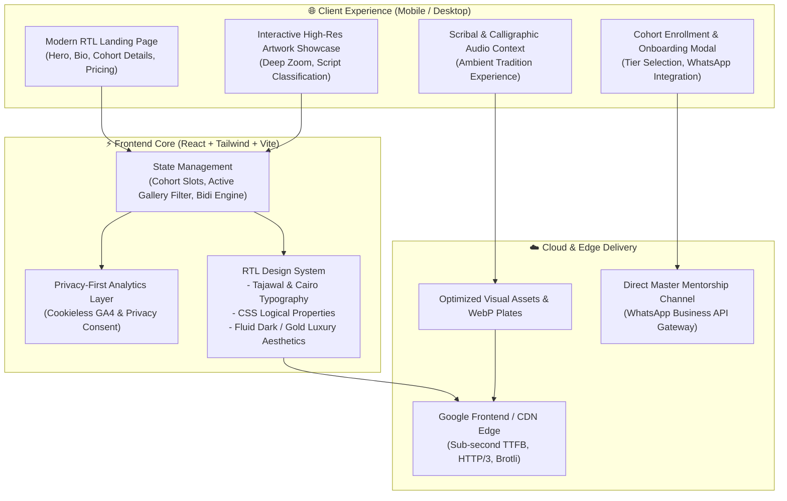
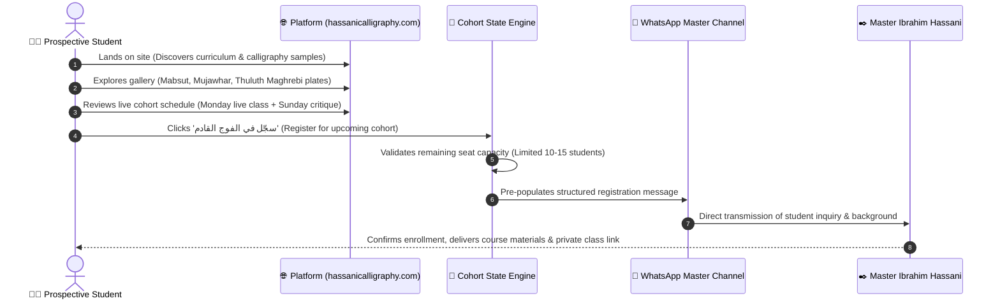
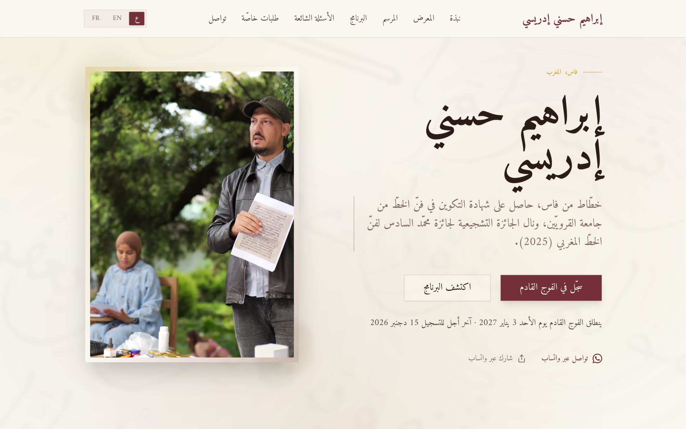
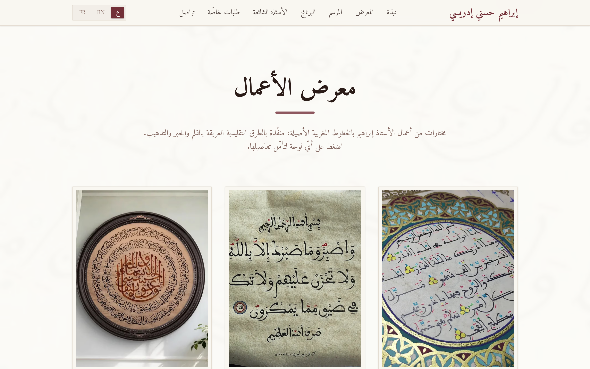
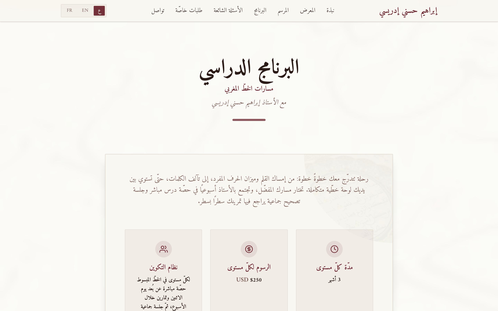
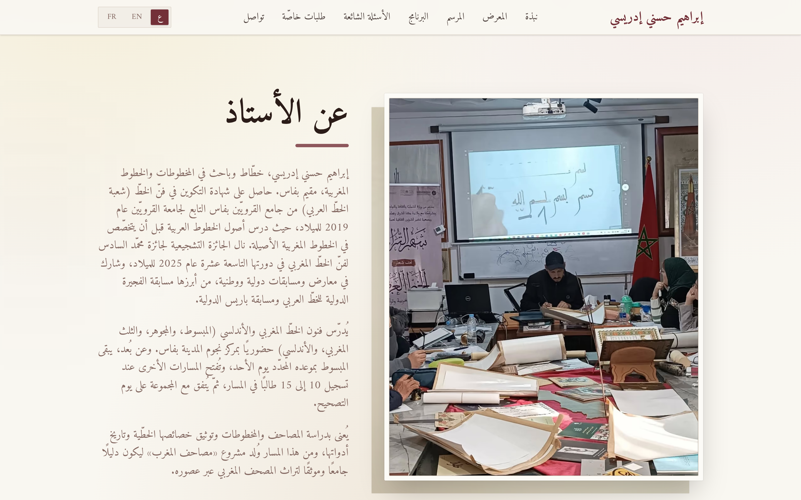
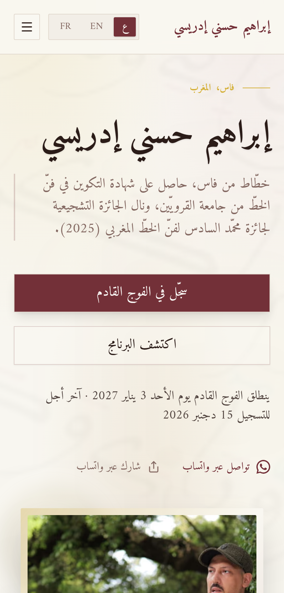

# Hassani Calligraphy — إبراهيم حسني إدريسي (الخط العربي المغربي)

**Interactive Digital Showcase, Virtual Academy & Distance Cohorts for Moroccan Arabic Calligraphy (`hassanicalligraphy.com`)**

[**🌐 Live Production Platform (hassanicalligraphy.com)**](https://hassanicalligraphy.com/)

---

## 📌 Executive Summary

**Hassani Calligraphy** ([`hassanicalligraphy.com`](https://hassanicalligraphy.com/)) is a production digital cultural platform and distance-learning academy built for master calligrapher, manuscript researcher, and teacher **Ibrahim Hassani Idrissi** (Fes, Morocco — recipient of the Mohammed VI Incentive Award for Moroccan Calligraphic Art, 2025, and graduate of Al-Qarawiyyin Mosque calligraphy program).

The platform serves two primary goals:
1. **Interactive Cultural Showcase**: High-resolution gallery, atelier tour (`المرسم`), and curated codicological context celebrating authentic Moroccan and Andalusi calligraphy styles (المبسوط، المجوهر، الثلث المغربي، والخط الأندلسي), alongside a cross-link to the companion manuscript encyclopedia [`masahif-al-maghrib.com`](https://masahif-al-maghrib.com).
2. **Virtual Masterclass & Cohort Enrollment**: A multilingual (`AR` / `EN` / `FR`) enrollment and onboarding funnel for small, intensive distance-learning cohorts (10 to 15 students per track, 3-month levels), featuring weekly live instructional sessions, structured homework critique schedules, and direct master feedback via WhatsApp.

---

## 🛠️ Cloud-to-Workstation Engineering Workflow (Replit SSH + Claude & Antigravity)

This client project is engineered and maintained using a **hybrid cloud-container + local Linux workstation architecture**:

- **Remote Replit Development Container over SSH**: The full-stack source workspace runs inside a dedicated Replit container connected directly to the local Linux workstation via SSH (`*.replit.dev:22`).
- **Multi-Agent Orchestration (Claude Code & Google Antigravity)**: Rather than relying on browser-based cloud editors, development, multilingual RTL layout refinement (`AR` / `EN` / `FR`), lazy-loaded section splitting, and performance tuning are steered directly from the Linux workstation over SSH using **Claude Code** and **Google Antigravity** (and mobile-steered via [`workstation-discord-bridge`](https://github.com/kmbenjel/workstation-discord-bridge)).
- **Production Bundle & Showcase Repository**: This repository (`kmbenjel/hassanicalligraphy.com`) houses the compiled Vite + React + Tailwind production assets (`public/assets/`, `public/images/`), architecture documentation, and visual showcase of the live platform at [`hassanicalligraphy.com`](https://hassanicalligraphy.com/).

---

## 🏗️ System Architecture & Component Interaction

---

## 🔄 Sequence Diagram: Student Onboarding & Cohort Journey

---

## ✒️ Typographic Styles Preserved

The digital gallery highlights the nuanced distinctions between classical Maghrebi calligraphic schools:

| Style (الأسلوب) | Codicological Role | Visual Characteristics |
|---|---|---|
| **الخط المبسوط (Al-Mabsut)** | Principal script for Qur'anic manuscripts and sacred texts | Rounded curves, deep open bowls (*nun*, *sad*), balanced proportions, and clear legibility. |
| **الخط المجوهر (Al-Mujawhar)** | Royal correspondence, legal edicts, and scholarly treaties | Fluid, ligature-rich, rapid cursive flow with tight vertical rhythm. |
| **الثلث المغربي (Maghrebi Thuluth)** | Monumental architectural inscriptions, illuminated headings | Towering ascenders, sharp architectural angles, and decorative majesty. |
| **الكوفي المربع (Square Kufic)** | Geometric architectural medallions and tilework (Zellij) | Strict orthogonal grid, binary ink/negative balance, mathematical precision. |

---

## 📸 Live Production UI Showcase (`hassanicalligraphy.com`)

| 🏛️ Trilingual (`AR` / `EN` / `FR`) Hero & Cohort Registration | ✒️ Interactive Artwork & Illuminated Manuscript Gallery (`معرض الأعمال`) |
|:---:|:---:|
|    *Warm parchment-inspired RTL landing interface with language switcher (`ع` / `EN` / `FR`), upcoming cohort countdown, and direct WhatsApp enrollment.* |    *Lazy-loaded high-resolution gallery showcasing traditional Maghrebi calligraphy plates executed with reed pen (*qalam*), natural ink, and gold leaf illumination (*tadhhib*).* |

 

| 📚 Distance Cohort Curriculum & Track Structure (`البرنامج الدراسي`) | 📜 Master Calligrapher Biography & Fes Atelier (`عن الأستاذ`) |
|:---:|:---:|
|    *Structured 3-month cohort levels across Mabsut, Mujawhar, Maghrebi Thuluth, and Andalusi scripts — combining weekly live classes with line-by-line group critique sessions.* |    *Academic and artistic profile of Master Ibrahim Hassani Idrissi (Al-Qarawiyyin graduate & 2025 Mohammed VI Calligraphy Award laureate) teaching in Fes.* |

 

| 📱 Mobile-First Responsive RTL Experience |
|:---:|
|    *Mobile-first responsive layout engineered with CSS Logical Properties, Amiri/Noto Naskh Arabic web fonts, and one-tap WhatsApp cohort registration.* |

---

## 👥 Credits

- **Master Calligrapher & Instructor:** [إبراهيم حسني إدريسي](https://hassanicalligraphy.com) (Ibrahim Hassani Idrissi), Fes, Morocco.
- **System Architecture & Full-Stack Development:** Built by [خالد بنجلون](https://benjelloun.dev) (Khalid Benjelloun) using Replit SSH, Claude Code, and [Google Antigravity](https://github.com/google).
