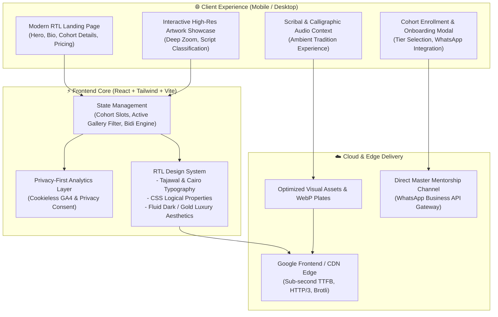
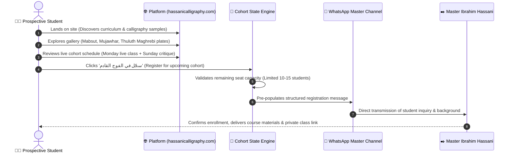

# Ibrahim Calligraphy (إبراهيم حسني إدريسي — الخط العربي المغربي)

**Interactive Digital Showcase, Virtual Academy & Distance Cohorts for Moroccan Arabic Calligraphy**

[**🌐 Live Production Platform (hassanicalligraphy.com / ibrahimcalligraphy.com)**](https://hassanicalligraphy.com/)

---

## 📌 Executive Summary

**Ibrahim Calligraphy** (`hassanicalligraphy.com` / `ibrahimcalligraphy.com`) is a digital cultural platform and distance-learning portal built for master calligrapher and teacher **Ibrahim Hassani Idrissi** (Fes, Morocco).

The platform serves two primary goals:
1. **Interactive Cultural Showcase**: High-resolution gallery and curated historical context celebrating authentic Moroccan calligraphy styles (المبسوط، المجوهر، الثلث المغربي، والكوفي المربع).
2. **Virtual Masterclass & Cohort Enrollment**: An optimized enrollment and onboarding funnel for small, intensive distance learning cohorts (10 to 15 students per group), featuring weekly live streaming sessions, structured homework critique schedules, and direct master feedback.

---

## 🏗️ System Architecture & Component Interaction

---

## 🔄 Sequence Diagram: Student Onboarding & Cohort Journey

---

## ✒️ Typographic Styles Preserved

The digital gallery highlights the nuanced distinctions between classical Maghrebi calligraphic schools:

| Style (الأسلوب) | Codicological Role | Visual Characteristics |
|---|---|---|
| **الخط المبسوط (Al-Mabsut)** | Principal script for Qur'anic manuscripts and sacred texts | Rounded curves, deep open bowls (*nun*, *sad*), balanced proportions, and clear legibility. |
| **الخط المجوهر (Al-Mujawhar)** | Royal correspondence, legal edicts, and scholarly treaties | Fluid, ligature-rich, rapid cursive flow with tight vertical rhythm. |
| **الثلث المغربي (Maghrebi Thuluth)** | Monumental architectural inscriptions, illuminated headings | Towering ascenders, sharp architectural angles, and decorative majesty. |
| **الكوفي المربع (Square Kufic)** | Geometric architectural medallions and tilework (Zellij) | Strict orthogonal grid, binary ink/negative balance, mathematical precision. |

---

## 📸 Visual Snapshots & Video Demos

> [!NOTE]
> Below are placeholder cards for desktop/mobile UI screen captures, high-resolution calligraphic artwork plates, and student workshop videos.

| 📱 Mobile-First RTL Landing Experience | ✒️ Interactive Artwork & Script Gallery |
|:---:|:---:|
|    *Seamless RTL enrollment flow with rich typography* |    *High-resolution inspection of classical Maghrebi scripts* |

 

| 🎥 Live Online Masterclass Demo Video | 📜 Master Calligrapher Profile & Biography |
|:---:|:---:|
|    *Video demonstration of live critique and pen technique* |    *Master Ibrahim Hassani Idrissi in his Fes workshop* |

---

## 👥 Credits

- **Master Calligrapher & Instructor:** [إبراهيم حسني إدريسي](https://hassanicalligraphy.com) (Ibrahim Hassani Idrissi), Fes, Morocco.
- **System Architecture & Development:** Built by [خالد بنجلون](https://benjelloun.dev) (Khalid Benjelloun) with [Google Antigravity](https://github.com/google).
