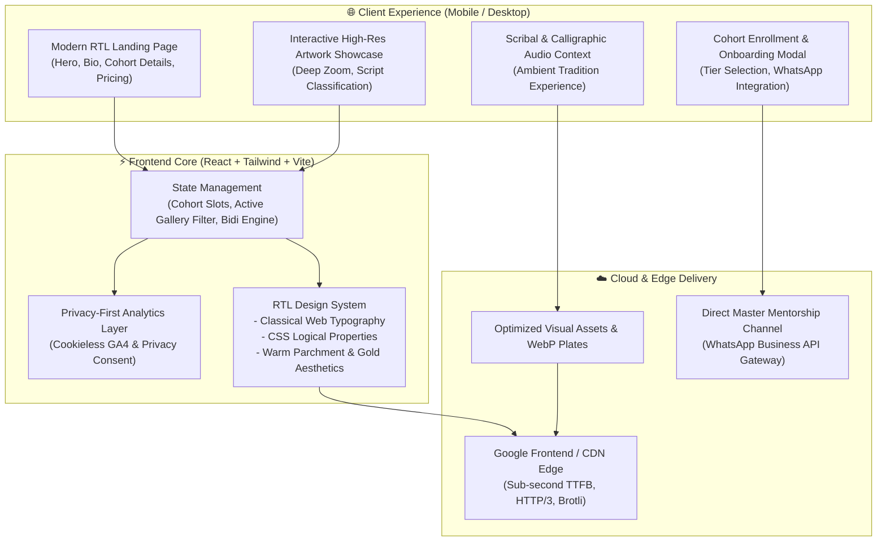
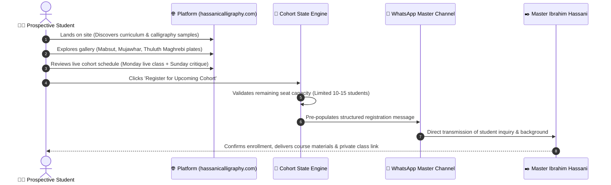

# Hassani Calligraphy

**Interactive Digital Showcase, Virtual Academy & Distance Cohorts for Moroccan Calligraphy (`hassanicalligraphy.com`)**

[-F26207?style=for-the-badge&logo=replit&logoColor=white)](https://hassanicalligraphy.com/)

[**🌐 Live Production Platform (hassanicalligraphy.com)**](https://hassanicalligraphy.com/)

---

## 📌 Executive Summary

**Hassani Calligraphy** ([`hassanicalligraphy.com`](https://hassanicalligraphy.com/)) is a production digital cultural platform and distance-learning academy built for master calligrapher, manuscript researcher, and teacher **Ibrahim Hassani Idrissi** (Fes, Morocco — recipient of the Mohammed VI Incentive Award for Moroccan Calligraphic Art, 2025, and graduate of the Al-Qarawiyyin Mosque calligraphy program).

The platform serves two primary goals:
1. **Interactive Cultural Showcase**: High-resolution gallery, atelier tour, and curated codicological context celebrating authentic Moroccan and Andalusi calligraphy styles (*Al-Mabsut*, *Al-Mujawhar*, *Maghrebi Thuluth*, and *Andalusi* script), alongside a cross-link to the companion manuscript encyclopedia [`masahif-al-maghrib.com`](https://masahif-al-maghrib.com).
2. **Virtual Masterclass & Cohort Enrollment**: A trilingual (`AR` / `EN` / `FR`) enrollment and onboarding funnel for small, intensive distance-learning cohorts (10 to 15 students per track, 3-month levels), featuring weekly live instructional sessions, structured homework critique schedules, and direct master feedback via WhatsApp.

---

## 🛠️ Engineering Workflow (Replit UI + Claude Code & Antigravity via VS Code Remote-SSH)

This client project was developed using a combined **Replit + VS Code Remote-SSH** workflow:

- **Replit Platform & UI**: Built and hosted on Replit using the standard Replit workspace UI and deployment pipeline.
- **Claude Code & Google Antigravity over VS Code SSH**: Connected **VS Code (and Antigravity IDE) via Remote-SSH** directly to the Replit project environment (`*.replit.dev:22`) to run **Claude Code** and **Google Antigravity** directly against the live Replit workspace.
- **Production Bundle & Showcase Repository**: This repository (`kmbenjel/hassanicalligraphy.com`) houses the compiled Vite + React + Tailwind production assets (`public/assets/`, `public/images/`), architecture documentation, and visual showcase of the live platform at [`hassanicalligraphy.com`](https://hassanicalligraphy.com/).

---

## 🏗️ System Architecture & Component Interaction

---

## 🔄 Sequence Diagram: Student Onboarding & Cohort Journey

---

## ✒️ Calligraphic Styles Preserved

The digital gallery highlights the nuanced distinctions between classical Maghrebi calligraphic schools:

| Style | Codicological Role | Visual Characteristics |
|---|---|---|
| **Al-Mabsut** | Principal script for Qur'anic manuscripts and sacred texts | Rounded curves, deep open bowls (*nun*, *sad*), balanced proportions, and clear legibility. |
| **Al-Mujawhar** | Royal correspondence, legal edicts, and scholarly treatises | Fluid, ligature-rich, rapid cursive flow with tight vertical rhythm. |
| **Maghrebi Thuluth** | Monumental architectural inscriptions, illuminated headings | Towering ascenders, sharp architectural angles, and decorative majesty. |
| **Square Kufic** | Geometric architectural medallions and tilework (*Zellij*) | Strict orthogonal grid, binary ink/negative balance, mathematical precision. |

---

## 📸 Live Production UI Showcase (`hassanicalligraphy.com`)

| 🏛️ Trilingual (`AR` / `EN` / `FR`) Hero & Cohort Registration | ✒️ Interactive Artwork & Illuminated Manuscript Gallery |
|:---:|:---:|
|    *Warm parchment-inspired RTL landing interface with language switcher (`AR` / `EN` / `FR`), upcoming cohort countdown, and direct WhatsApp enrollment.* |    *Lazy-loaded high-resolution gallery showcasing traditional Maghrebi calligraphy plates executed with reed pen (*qalam*), natural ink, and gold leaf illumination (*tadhhib*).* |

 

| 📚 Distance Cohort Curriculum & Track Structure | 📜 Master Calligrapher Biography & Fes Atelier |
|:---:|:---:|
|    *Structured 3-month cohort levels across Mabsut, Mujawhar, Maghrebi Thuluth, and Andalusi scripts — combining weekly live classes with line-by-line group critique sessions.* |    *Academic and artistic profile of Master Ibrahim Hassani Idrissi (Al-Qarawiyyin graduate & 2025 Mohammed VI Calligraphy Award laureate) teaching in Fes.* |

 

| 📱 Mobile-First Responsive RTL Experience |
|:---:|
|    *Mobile-first responsive layout engineered with CSS Logical Properties, classical web fonts, and one-tap WhatsApp cohort registration.* |

---

## 👥 Credits

- **Master Calligrapher & Instructor:** [Ibrahim Hassani Idrissi](https://hassanicalligraphy.com), Fes, Morocco.
- **System Architecture & Full-Stack Development:** Built by [Khalid Benjelloun](https://benjelloun.dev) using Replit, alongside Claude Code and [Google Antigravity](https://github.com/google) via a VS Code Remote-SSH connection to the Replit workspace.
